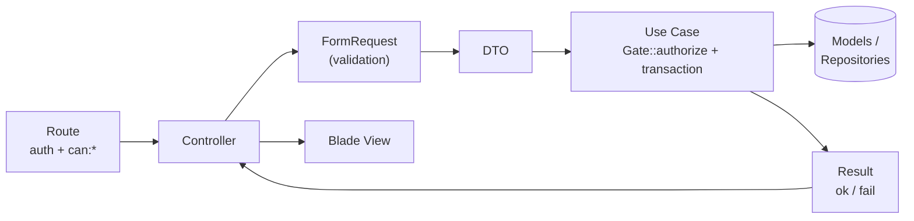
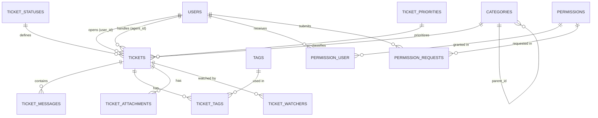
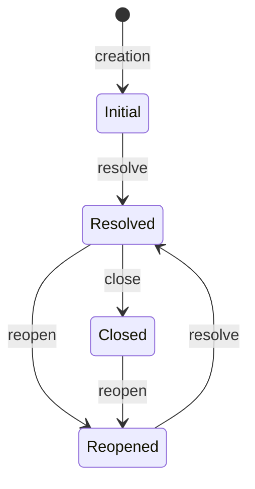
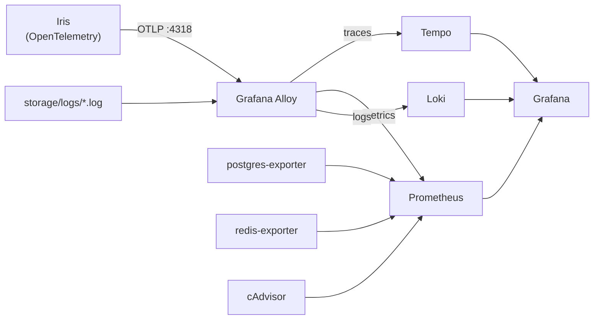

# Iris

<p align="center">
  A <strong>helpdesk ticketing system</strong> built with Laravel, featuring granular permission-based authorization,<br>
  Snowflake IDs, a Use Case-based architecture, and OpenTelemetry observability.
</p>

<p align="center">
  
  
  
  
  
  
</p>

---

## Table of Contents

- [About](#about)
- [Features](#features)
- [Tech Stack](#tech-stack)
- [Architecture](#architecture)
- [Data Model](#data-model)
- [Authorization and Permissions](#authorization-and-permissions)
- [Ticket Lifecycle](#ticket-lifecycle)
- [Getting Started](#getting-started)
- [Post-Installation Setup](#post-installation-setup)
- [Environment Variables](#environment-variables)
- [Useful Commands](#useful-commands)
- [Testing](#testing)
- [Observability](#observability)
- [CI/CD](#cicd)
- [Project Structure](#project-structure)
- [Known Limitations](#known-limitations)
- [License](#license)

---

## About

**Iris** is a web-based ticket management application. Users submit tickets, agents track, respond to, and resolve them, and administrators control who can perform specific actions through a granular permission system (`module.action`).

Key design principles include:

- **Use Cases** (`App\Services`) encapsulate business rules. Controllers are responsible only for orchestration.
- **64-bit Snowflake IDs**, generated by the application instead of relying on auto-incrementing IDs.
- **Layered authorization**: `can:*` middleware on routes, `Gate::authorize` inside Use Cases, and policies for record-level authorization rules.
- **Observability from day one**: traces through OpenTelemetry, logs in Loki, and dashboards in Grafana.
- **Automated setup**: a single command creates the database, runs migrations, and provisions permissions and the Super Admin account.

## Features

| Area                 | Features                                                                                                                                                     |
| -------------------- | ------------------------------------------------------------------------------------------------------------------------------------------------------------ |
| **Authentication**   | Login, public registration, and logout.                                                                                                                      |
| **Dashboard**        | Metrics for the logged-in user's tickets and a filterable ticket list by category, priority, and status.                                                     |
| **Tickets**          | Create tickets, browse with advanced filters and pagination, view details, edit and delete tickets, view "my tickets," and edit or delete one's own tickets. |
| **Ticket lifecycle** | Resolve, close, and reopen tickets, with transition rules (see [Ticket Lifecycle](#ticket-lifecycle)).                                                       |
| **Messages**         | Replies and internal notes on each ticket, threaded replies, and editing and deletion by the author.                                                         |
| **Categories**       | Hierarchical categories (`parent_id`), with enable/disable functionality.                                                                                    |
| **Tags**             | Tags with types (`GENERAL`, `SYSTEM`, `CONTENT`, `PRODUCT`, `STATUS`), with enable/disable functionality.                                                    |
| **Ticket statuses**  | Configurable ordering, color, icon, and flags (`is_initial`, `is_final`, `stops_sla`, `requires_comment`).                                                   |
| **Priorities**       | Priority levels with response, resolution, and escalation time targets.                                                                                      |
| **Users**            | Profiles, editing, password changes, listing, and status management (`ACTIVE`, `INACTIVE`, `SUSPENDED`).                                                     |
| **Permissions**      | Permission catalog, user permission assignments (with soft deletion and restoration), and permission requests with a review workflow.                        |

## Tech Stack

| Layer                      | Technology                                                               |
| -------------------------- | ------------------------------------------------------------------------ |
| Language / Framework       | PHP 8.3+ (Docker image uses PHP 8.5) and Laravel 13                      |
| Database                   | PostgreSQL 16 (SQLite as the default for local development)              |
| Cache, Sessions, and Queue | Redis via Predis in Docker; `database` drivers in `.env.example`         |
| Frontend                   | Blade, Tailwind CSS 4 + Vite 8, Alpine.js 3, and Font Awesome 6          |
| IDs                        | [`godruoyi/php-snowflake`](https://github.com/godruoyi/php-snowflake)    |
| Telemetry                  | OpenTelemetry (SDK, Laravel and PDO auto-instrumentation, OTLP exporter) |
| Observability              | Grafana Alloy, Prometheus, Loki, Tempo, and Grafana                      |
| Quality                    | PHPUnit 12, Mockery, PHP_CodeSniffer (PSR-12), and Laravel Pint          |
| CI/CD                      | Jenkins, Docker, and Trivy                                               |

## Architecture

Every request follows the same flow:



**Code conventions**

- **Use Cases** (`app/Services/<Module>/`): one class per action (`CreateTicketUseCase`, `CloseTicketUseCase`, etc.), exposing an `execute()` method. Data-modifying operations run inside transactions, and many use `lockForUpdate()`.
- **DTOs** (`app/DTOs/<Module>/`): input objects (`Create*`, `Update*`) and filter objects (`Filter*`), constructed from the corresponding `FormRequest`.
- **`Result`** (`app/Utils/Result`): explicit success or failure results (`Result::ok($value)` / `Result::fail($message, $code)`), avoiding exceptions for business-flow control.
- **Repositories** (`app/Repository`): interfaces for `User`, `Category`, and `Tag`, bound in `AppServiceProvider`. Other modules access models directly from their Use Cases.
- **Models** use the `Model` suffix, except for `User`. They set `$incrementing = false`, use `SoftDeletes`, and have a `version` column incremented on each change.
- **Enums** (`app/Utils/Enums`): column names, statuses, and the permission slug enum.
- **Snowflake** (`app/Utils/Snowflake`): `IdGeneratorInterface` is injected into Use Cases. The worker ID defaults to `1` (valid range: 0–31).

## Data Model



The full diagram, including all columns, is available at `database/migrations/iris_db - iris_db - schema.png`.

**Notable design decisions**

- All primary keys are application-generated `unsignedBigInteger` values using Snowflake IDs. In `tickets`, `ticket_number` is a human-readable sequential number, separate from the `id`.
- The `users.permissions` JSON column stores a copy of the user's permissions, allowing Gates to avoid querying the database on every authorization check. The source of truth is the `permission_user` table.
- `permission_user` uses soft deletion: revoking a permission does not delete the row, and restoration is handled by a dedicated action.
- Priorities model SLA targets (`response_time_minutes`, `resolution_time_minutes`, `escalation_time_minutes`), while tickets include `due_at`, `first_response_at`, `resolved_at`, and `closed_at`.
- `tickets.source` accepts `WEB`, `EMAIL`, `API`, `CHAT`, `WHATSAPP`, and `PHONE`.

## Authorization and Permissions

Permissions follow the `module.action` naming convention (for example, `ticket.create` and `category.update`).

- `PermissionBootstrapper` provisions the catalog of **90 permissions** across 12 modules: `auth`, `users`, `permissions`, `categories`, `tags`, `ticket_statuses`, `ticket_priorities`, `tickets`, `ticket_messages`, `ticket_attachments`, `ticket_watchers`, and `permission_requests`. The operation is idempotent.
- `SuperAdminBootstrapper` creates the Super Admin account and grants it all permissions.
- Users with `super.adm` bypass all permission checks through `Gate::before`.
- Routes use `can:<slug>`, while Use Cases reinforce authorization with `Gate::authorize`.
- Record-level rules (for example, "only the author can edit their own message") are enforced through policies: `TicketModelPolicy` and `TicketMessagePolicy`.

**Permission workflow for a new user**

1. A user registers at `/auth/register`. They **do not receive any permissions**.
2. They can submit a permission request at `/permission-request`, providing a reason.
3. A reviewer approves or rejects the request. Approval records the decision; the **actual permission grant** takes place in _User Permissions_ (`/permission-user`).
4. Granting rules: users cannot assign permissions to their own accounts, and only a Super Admin can grant administrative permissions or assign permissions to administrators.

## Ticket Lifecycle



Transitions depend on the **status codes** configured in the system:

| Action      | Rule                                                                                                                                                                                 |
| ----------- | ------------------------------------------------------------------------------------------------------------------------------------------------------------------------------------ |
| **Create**  | Requires exactly **one** active status with `is_initial = true`, as well as an active category and priority. The ticket is created without an assigned agent.                        |
| **Resolve** | Requires an active status with the code `RESOLVED`. Tickets that are closed or already resolved cannot be resolved again.                                                            |
| **Close**   | Only resolved tickets can be closed. Requires an active status with the code `CLOSED`.                                                                                               |
| **Reopen**  | Only resolved or closed tickets can be reopened. Uses the `REOPENED` status, or `OPEN`, or the initial status if neither is available. Clears the resolution and closure timestamps. |

Each transition updates `last_activity_at`, increments `version`, and runs inside a transaction with row-level locking.

## Getting Started

### Prerequisites

- **Docker** and **Docker Compose** (recommended), or
- PHP 8.3+ (with `bcmath`, `intl`, `pcntl`, `pdo_pgsql`, and `zip`), Composer 2, and Node.js for running locally.

### With Docker (recommended)

```bash
# 1. Environment variables
cp .env.example .env

# 2. Generate an APP_KEY and add it to .env
docker run --rm php:8.5-cli-alpine php -r 'echo "base64:".base64_encode(random_bytes(32)).PHP_EOL;'

# 3. Set the Super Admin credentials in .env
#    SUPER_ADMIN_EMAIL, SUPER_ADMIN_NAME, SUPER_ADMIN_FULL_NAME, SUPER_ADMIN_PASSWORD

# 4. Start the application and its dependencies
docker compose up -d --build app
```

On startup, the container runs `entrypoint.sh`, validates `APP_KEY`, executes `php artisan iris:setup` (creates the database if it does not exist, runs migrations, and provisions permissions and the Super Admin), and only then starts the server. The application is available at [**http://localhost:8000**](http://localhost:8000).

> `docker compose up -d --build app` also starts the app's dependencies: PostgreSQL, Redis, Alloy, Prometheus, Loki, Tempo, and the exporters. Grafana, cAdvisor, and Jenkins are excluded. To start **everything**, run `docker compose up -d --build`.

| Service    | URL / Port                                       | Notes                                                                                                     |
| ---------- | ------------------------------------------------ | --------------------------------------------------------------------------------------------------------- |
| Iris       | [http://localhost:8000](http://localhost:8000)   | Application                                                                                               |
| Grafana    | [http://localhost:3000](http://localhost:3000)   | Credentials: `GRAFANA_ADMIN_USER` / `GRAFANA_ADMIN_PASSWORD` (defaults to `admin` / `admin`; change them) |
| Prometheus | [http://localhost:9090](http://localhost:9090)   | Metrics                                                                                                   |
| Loki       | [http://localhost:3100](http://localhost:3100)   | Logs                                                                                                      |
| Tempo      | [http://localhost:3200](http://localhost:3200)   | Traces                                                                                                    |
| Alloy      | [http://localhost:12345](http://localhost:12345) | Collector UI. OTLP on ports `4317` (gRPC) and `4318` (HTTP)                                               |
| cAdvisor   | [http://localhost:8085](http://localhost:8085)   | Container metrics                                                                                         |
| PostgreSQL | `localhost:5433`                                 | Mapped from `5432` (`DB_PORT`)                                                                            |
| Redis      | `localhost:6379`                                 |                                                                                                           |
| Jenkins    | [http://localhost:8080](http://localhost:8080)   | See CI/CD                                                                                                 |

> `compose.yaml` sets `APP_ENV: local`. Since the PHP built-in server (`artisan serve`) runs inside the container, this configuration is suitable for development and demonstrations. For production, run the application behind a dedicated web server.

### Locally (without Docker)

The `.env.example` uses **SQLite** and `database` drivers, so PostgreSQL and Redis are not required:

```bash
cp .env.example .env
composer install
php artisan key:generate

# If no local OpenTelemetry collector is running, disable auto-instrumentation in .env:
#   OTEL_PHP_AUTOLOAD_ENABLED=false

php artisan iris:setup          # Creates the database, runs migrations, and provisions permissions + Super Admin

npm install --ignore-scripts
npm run build                   # Or `npm run dev` during development

php artisan serve               # http://localhost:8000
```

The `composer.json` file also defines the `composer setup` and `composer dev` shortcuts.

## Post-Installation Setup

The database starts **without any reference data**. Sign in as the Super Admin (using the email and password configured in `.env`) and create the following, in this order:

1. **Ticket statuses**: at least one initial status (`is_initial`, for example, code `OPEN`), one with the code **`RESOLVED`**, and one with the code **`CLOSED`**. `REOPENED` is optional.
2. **Priorities**: at least one active priority, with a level, color, and SLA time targets.
3. **Categories**: at least one active category.
4. _(Optional)_ **Tags**.

Without these records, tickets cannot be created or transitioned through their lifecycle.

> If `SUPER_ADMIN_PASSWORD` is empty, the default Super Admin password is `password123` outside production. When `APP_ENV=production`, setup **fails** if the password is not configured. Always set your own password.

## Environment Variables

The `.env.example` file contains the complete configuration. The main variables are:

| Variable                                                          | Description                                                          | Default                                |
| ----------------------------------------------------------------- | -------------------------------------------------------------------- | -------------------------------------- |
| `APP_KEY`                                                         | Application key (required). The container will not start without it. | Empty                                  |
| `APP_ENV` / `APP_DEBUG`                                           | Environment and debug mode.                                          | `local` / `true`                       |
| `DB_CONNECTION`                                                   | `sqlite` or `pgsql`. Compose forces `pgsql`.                         | `sqlite`                               |
| `DB_HOST`, `DB_PORT`, `DB_DATABASE`, `DB_USERNAME`, `DB_PASSWORD` | PostgreSQL connection settings.                                      | See `compose.yaml`                     |
| `DB_SETUP_MAX_ATTEMPTS`                                           | Number of `iris:setup` attempts before giving up.                    | `5`                                    |
| `DB_SETUP_RETRY_DELAY`                                            | Seconds between retries.                                             | `3`                                    |
| `SUPER_ADMIN_EMAIL`                                               | Super Admin email address.                                           | `admin@admin.com`                      |
| `SUPER_ADMIN_NAME` / `SUPER_ADMIN_FULL_NAME`                      | Super Admin display name and full name.                              | `Super Admin` / `Administrator System` |
| `SUPER_ADMIN_PASSWORD`                                            | Super Admin password (required in production).                       | Empty                                  |
| `SESSION_DRIVER`, `CACHE_STORE`, `QUEUE_CONNECTION`               | Application drivers. Compose uses `redis` for all three.             | `database`                             |
| `REDIS_CLIENT`                                                    | Redis client. The project uses **Predis**.                           | `predis` in Compose                    |
| `OTEL_PHP_AUTOLOAD_ENABLED`                                       | Enables OpenTelemetry auto-instrumentation.                          | `true`                                 |
| `OTEL_SERVICE_NAME`                                               | Telemetry service name.                                              | `iris`                                 |
| `OTEL_EXPORTER_OTLP_ENDPOINT`                                     | OTLP endpoint (`http://alloy:4318` in Compose).                      | `http://localhost:4318`                |
| `RUN_SETUP`                                                       | In the container, `false` skips `iris:setup`.                        | `true`                                 |
| `DOCKER_GID`                                                      | Host Docker group GID, used by Jenkins to access the socket.         | `999`                                  |

> When creating `.env` from `.env.example`, remove the duplicate `APP_NAME = IRIS` line or the earlier `APP_NAME=Laravel` definition to avoid defining the same variable twice.

## Useful Commands

```bash
# Creates the database if needed, runs migrations, and provisions permissions + Super Admin.
# Safe to rerun (idempotent); retries if a failure occurs.
php artisan iris:setup

# Database + migrations only, without permissions or Super Admin
php artisan iris:setup --skip-bootstrap

# Tests
composer test                   # Clears the configuration cache and runs `artisan test`

# Code style (PSR-12)
vendor/bin/phpcs --standard=PSR12 --extensions=php app
vendor/bin/pint --test

# Run individual commands inside the container
docker compose run --rm app php artisan tinker
```

## Testing

- **46 test files** and approximately **200 test cases**, mostly **unit tests**, covering the Use Cases for tickets, messages, categories, tags, priorities, statuses, permissions, permission requests, and users.
- Tests run with **in-memory SQLite** (configured in `phpunit.xml`) and do not require PostgreSQL or Redis.
- Test support utilities are located in `tests/Help`.

```bash
composer test
# or
php artisan test
```

## Observability



- The application is instrumented with OpenTelemetry (Laravel and PDO) and exports telemetry through OTLP/HTTP.
- **Alloy** receives and routes telemetry: traces go to Tempo, metrics go to Prometheus through _remote write_, and Laravel logs are read from the `storage` volume and forwarded to Loki.
- Prometheus also scrapes PostgreSQL, Redis, and container metrics from cAdvisor.
- Grafana starts with Prometheus, Tempo, and Loki data sources already provisioned.
- Configuration files are located in `docker/observability/`.

## CI/CD

The repository includes a `Jenkinsfile` with three stages:

1. **Build image**: runs `docker build` with the `${BUILD_NUMBER}` and `latest` tags.
2. **Scan image with Trivy**: scans for `HIGH` and `CRITICAL` vulnerabilities. The stage marks the build as unstable without blocking the pipeline.
3. **Push to Docker Hub**: publishes both tags to `andersoncrms/iris`.

The `compose.yaml` file includes a **Jenkins** service with the Docker CLI and plugins (`docker/jenkins/`). It uses the host's `docker.sock` to build images, and includes a **Trivy** service under the `tools` profile:

```bash
# Host Docker group GID (required for Jenkins to access the socket)
stat -c '%g' /var/run/docker.sock      # Set DOCKER_GID in .env

docker compose up -d --build jenkins

# Initial Jenkins password
docker compose exec jenkins cat /var/jenkins_home/secrets/initialAdminPassword

# Run a manual Trivy scan
docker compose run --rm trivy image iris-app
```

Create the `dockerhub-creds` credential in Jenkins using your Docker Hub username and access token.

> Mounting `docker.sock` is equivalent to granting administrative access to the host. Use this setup only in lab or controlled environments.

## Project Structure

```text
iris/
├── app/
│   ├── Bootstrap/          # PermissionBootstrapper, SuperAdminBootstrapper
│   ├── Console/Commands/   # iris:setup
│   ├── DTOs/               # Create*, Update*, Filter* per module
│   ├── Http/
│   │   ├── Controllers/    # One controller per module
│   │   └── Requests/       # FormRequests (validation)
│   ├── Models/             # Eloquent models (Model suffix)
│   ├── Policies/           # TicketModelPolicy, TicketMessagePolicy
│   ├── Providers/          # AppServiceProvider (gates, policies, bindings)
│   ├── Repository/         # Interfaces and implementations
│   ├── Services/           # Use Cases, grouped by module
│   └── Utils/
│       ├── Enums/          # Columns, statuses, and SlugPermissionEnum
│       ├── Result/         # Result ok/fail
│       └── Snowflake/      # ID generator
├── config/iris.php         # Database setup and Super Admin configuration
├── database/
│   ├── migrations/         # Schema and ER diagram (PNG)
│   ├── factories/
│   └── seeders/
├── docker/
│   ├── entrypoint.sh       # Automatic setup + configuration caching in production
│   ├── jenkins/            # Jenkins image (Docker CLI + plugins)
│   └── observability/      # Alloy, Prometheus, Loki, Tempo, Grafana
├── resources/              # Blade views, CSS, and JS (Vite + Tailwind)
├── routes/web.php          # Routes grouped by module
├── tests/                  # Unit (Use Cases), Feature, and Help
├── compose.yaml
├── Dockerfile
└── Jenkinsfile
```

## Known Limitations

- **Ticket attachments and watchers**: the tables, models, and permissions exist (`ticket_attachments`, `ticket_watchers`), but screens and routes for these features have not been implemented yet.
- **Teams**: `tickets.team_id` exists as a column, but there is no associated team entity.
- **Open public registration**: anyone can create an account, but no permissions are granted until an administrator assigns them.
- **PHP built-in server** in the container: suitable for development and demonstrations.
- **Web interface only**: there is no REST API. All interaction takes place through Blade views.

## License

Distributed under the [MIT License](https://opensource.org/licenses/MIT), as declared in `composer.json`.
